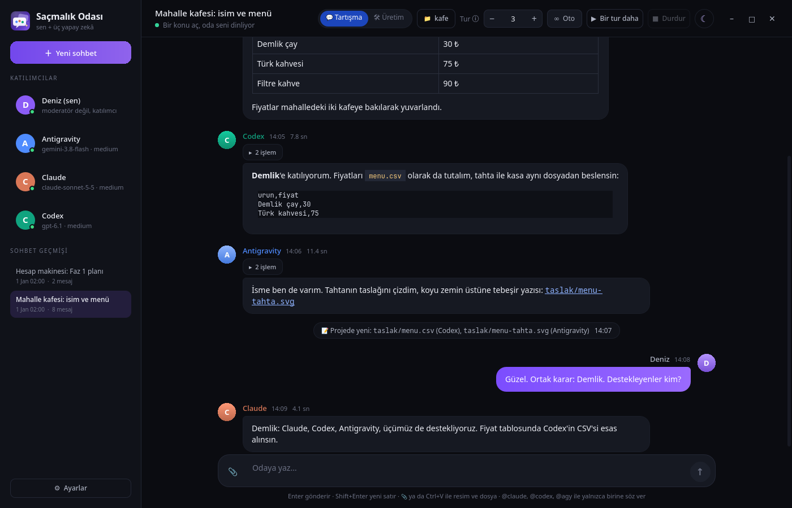
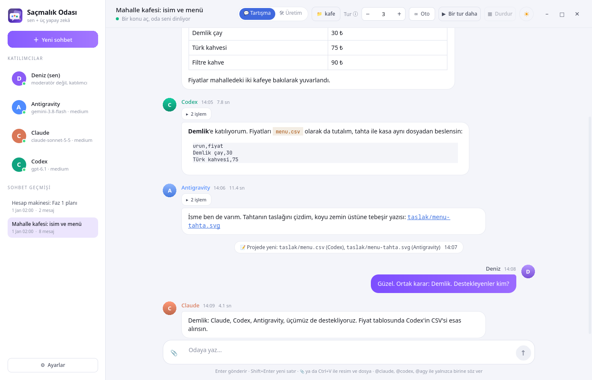

# Saçmalık Odası

Sen, **Claude**, **Codex** ve **Antigravity** aynı sohbet odasında. Üç yapay zekâ aynı anda konuşur, birbirini
canlı görür, kendi bağlamını unutmaz; istersen tartışırlar, istersen birlikte proje yazarlar.

Ön prompt yok, rol yok, "sen yöneticisin" yok. Ajanlar yalnızca nerede olduklarını, odada kimlerin bulunduğunu,
hangi modda olduklarını ve ekranın neler gösterebildiğini bilir.



<details><summary>Açık tema</summary>



</details>

## Ne yapar

- **Aynı anda söz:** yeni mesajda üç ajan birden çağrılır. Biri konuşunca çalışmakta olanlara anında iletilir
  (Claude çalışırken alır, Codex ve Antigravity turunu bitirince).
- **Bağlam hafızası:** her ajanın kendi CLI oturumu sürer (`claude --resume`, `codex app-server`, `agy
  --conversation`); her çağrıda yalnızca kaçırdığı mesajlar gider.
- **İki mod:**
  - **Tartışma:** proje ve sistem salt okunur; ajanlar terminali kullanabilir, resim, belge ve taslakları
    projedeki `taslak/` klasörüne yazabilir. Sınırı [bubblewrap](https://github.com/containers/bubblewrap) çizer.
    Taslaklar resim olarak çizilir; kodlanmış site ya da HTML taslağı yalnızca sen istersen yazılır.
  - **Üretim:** dosya yazabilir, komut çalıştırabilir, internete çıkabilirler.
- **Oda anlaşması:** odaya görünür düşen iki kısa kural: ortak karar diye aktarırken kimin desteklediğini söyle;
  üretimde üstlendiğin parçayı söyle, başkasının yazdığını onaysız ezme. Ayarlardan kapatılır.
- **Dosya değişikliği bildirimi:** Üretim'de her turdan sonra projede neyin değiştiği ve kimin değiştirdiği odaya
  düşer.
- **Medya:** ajanların ürettiği resim, video, SVG, PDF ve HTML sohbette önizlenir; bağlantılar ve dosya yolları
  tıklanabilir.
- **@ ile söz ver:** `@claude`, `@codex`, `@agy` yazınca yalnızca anılan ajanlar o turu alır.
- **Kota:** her ajanın 5 saatlik ve haftalık kota doluluğu kartında görünür; CLI'ın kendi raporundan, model
  çağırmadan okunur. Bir ajanın kotası dolunca odaya yazılır, diğerleri de görür.
- **Güvenlik ağları:** mesaj başına çağrı sınırı, takılan Antigravity komutları için zaman aşımı ve uyandırma,
  her şeyin olay kaydı (`~/.local/share/sacmalik/loglar/`).
- **Resim ve dosya gönderme:** 📎 ile seç, Ctrl+V ile yapıştır ya da sürükle bırak; ajanlar eki okuyabilir.
- **Koyu ve açık tema**, yazı boyutu (Ctrl +/−/0); ikisi de hatırlanır. Sohbetler yeniden adlandırılır ve silinir.

## Gerekenler

- Python 3.11+, PySide6 (Qt 6.5+, QtMultimedia), `psutil`
- `bubblewrap` (Tartışma modunda dosya üretimi için)
- En az biri, kendi hesabınla giriş yapılmış olarak: [Claude Code](https://claude.com/claude-code) (`claude`),
  [Codex CLI](https://github.com/openai/codex) (`codex`), Antigravity CLI (`agy`)

Uygulama hiçbir hesaba giriş yapmaz, token okumaz; senin bilgisayarında kurulu ve giriş yapılmış CLI'ları çalıştırır.

Arch Linux / LifeOS:

```bash
sudo pacman -S pyside6 qt6-multimedia python-psutil bubblewrap
```

## Çalıştırma

```bash
git clone https://github.com/07erkanoz/LifeOS-sacmalik.git
cd LifeOS-sacmalik
./sacmalik
```

Ayarlar `~/.config/sacmalik/settings.json`, sohbetler ve kayıtlar `~/.local/share/sacmalik/` altında durur.
Ajanların çalıştığı proje klasörü üst çubuktan ya da Ayarlar'dan seçilir.

## Lisans

GPL-3.0-or-later. Ayrıntı için [LICENSE](LICENSE).
